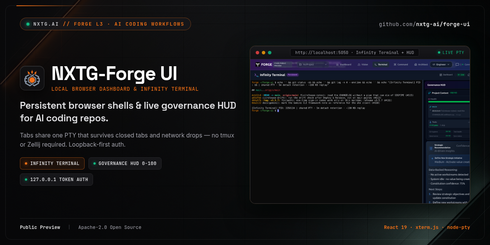
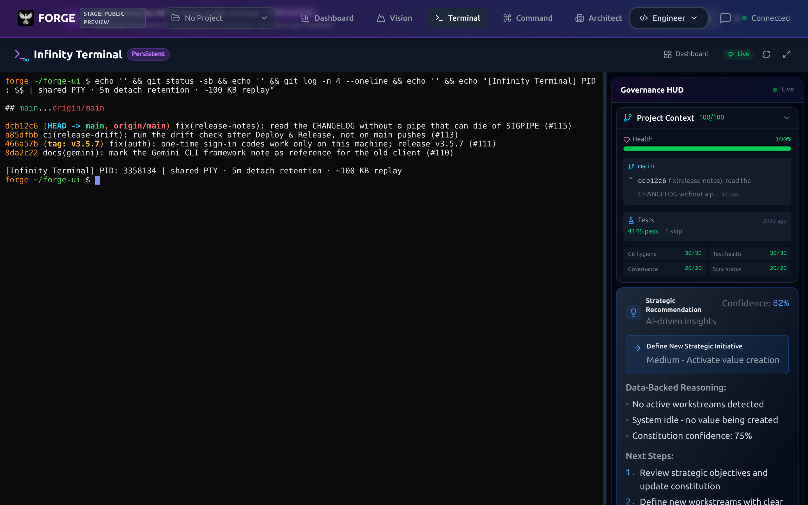
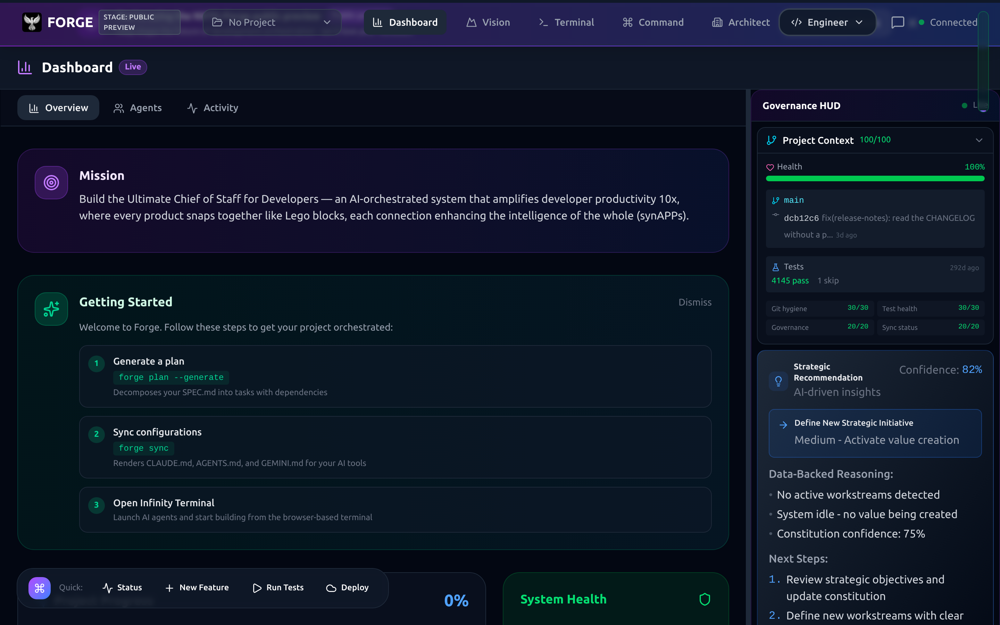
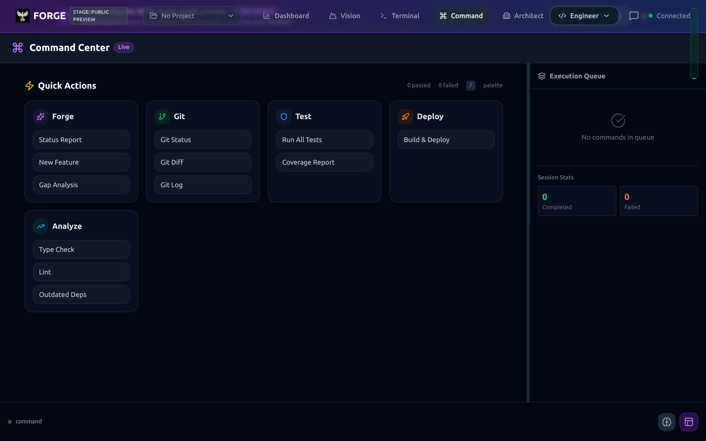

<p align="center">
  
  <br>Reconnect to your local project shell from a browser and see project health alongside it.
</p>
# NXTG Forge UI

[](STAGE)

**Stage: Public preview.** The Forge plugin and orchestrator are in alpha. This dashboard, forge-ui, was not part of the pre-registered core-job test behind that stage and is still a public preview.

[](https://github.com/nxtg-ai/forge-ui/actions/workflows/quality-gates.yml) [](https://github.com/nxtg-ai/forge-ui/actions/workflows/terminal-e2e.yml) [](https://github.com/nxtg-ai/forge-ui/actions/workflows/security-scan.yml) [](LICENSE.md) [](https://github.com/nxtg-ai/forge-ui/releases/tag/v3.5.8) [](package.json)

**NXTG-Forge UI (L3: Ship Lord)** is an open-source, local-first browser dashboard and persistent terminal (**Infinity Terminal**) for AI-assisted coding workflows — built with React 19, Express 5, `xterm.js` 6, and `node-pty`.

> **Disambiguation:** This is **NXTG-Forge UI** (`nxtg-ai/forge-ui`), the browser dashboard for the [NXTG-Forge](https://forge.nxtg.ai) AI coding orchestration suite. It is **unrelated to Stable Diffusion WebUI Forge**.  
> **License:** Open source under the [Apache License, Version 2.0](./LICENSE.md) (see [NOTICE](./NOTICE)).

<p align="center">
  
</p>

## Why NXTG-Forge UI Exists

When you run long-lived AI coding sessions across a workstation, WSL2, or a second device on your LAN, two routine failures break flow:

1. **Closing a browser tab or dropping Wi-Fi kills your shell** unless you maintain tmux/Zellij + SSH tunnels by hand.
2. **Project governance and health stay invisible** inside hidden JSON files while agents edit your repository.

`forge-ui` solves both locally — binding `127.0.0.1` by default with zero third-party cloud relay:

- **Infinity Terminal:** A shared browser PTY over WebSocket + `node-pty`. Multiple tabs attach to the same shell. Close the tab or lose the network and the shell keeps running for **5 minutes**, replaying up to **~100 KB** of recent scrollback on reconnect (no tmux or Zellij required; restarting the `forge-ui` server still ends the shell).
- **Live Governance HUD:** Shows a **0–100 health score** and live governance state for the workspace `forge-ui` runs from — backed by [forge-orchestrator](https://github.com/nxtg-ai/forge-orchestrator) (L2) when installed, `.claude/governance.json` from [forge-plugin](https://github.com/nxtg-ai/forge-plugin) (L1), or a clearly labeled local estimate when running standalone. Policy enforcement stays in Forge's CLI/hooks, never in the frontend.
- **Command Center:** Triggers a fixed set of project status, test, type-check/build pre-flight, and gap-analysis commands directly from the browser.
- **Local-First Token Auth & Opt-In Multi-Device Access:** Listens on `127.0.0.1` only (`:5050` UI / `:5051` API) with a `0600` bearer token and 60-second single-use login codes.

<details>
<summary><strong>More screenshots: Live Dashboard &amp; Command Center</strong></summary>

<p align="center">
  
</p>
<p align="center">
  
</p>

</details>

## Quickstart

### Prerequisites

- **Node.js 22.12 or later** (Vite 7 requires `^20.19 || >=22.12`; `package.json` specifies `>=22.0.0`)
- **Native C/C++ build tools** (`python3`, `make`, `g++`) — `node-pty@1.1.0` compiles from source via `node-gyp` when no prebuild matches your OS/architecture:
  - **Debian / Ubuntu / WSL2:** `sudo apt-get install -y python3 make g++`
  - **macOS:** `xcode-select --install`
- **Optional:** [Forge Orchestrator](https://github.com/nxtg-ai/forge-orchestrator) (`forge` on `PATH` or `FORGE_BIN`) for orchestrator-backed health scores

### Install & Run Standalone

```bash
git clone --branch v3.5.8 https://github.com/nxtg-ai/forge-ui
cd forge-ui
npm install
npm run dev
```

Runs standalone without the Forge plugin or orchestrator (verified in a clean `node:22-slim` container with `python3`, `make`, and `g++`). With [Forge Orchestrator](https://github.com/nxtg-ai/forge-orchestrator) (L2) installed, the Governance HUD reads live orchestrator state automatically.

### Sign-In and Network Access

The dashboard requires this install's access token on first open. In a second terminal on the machine running `forge-ui`:

```bash
# Recommended: single-use 60-second sign-in link (keeps the long-lived token out of browser history)
npm run auth:login-link

# Or print the direct access-token link (human interactive use only):
npx tsx src/server/auth/print-auth-url.ts      # or: node dist/server/auth/print-auth-url.js
```

Open the printed URL (`http://localhost:5050/...`). The underlying secret is created on first run at `~/.config/nxtg-forge/ui-secret` (mode `0600`) and can also be pasted into the sign-in screen or sent as `Authorization: Bearer <token>`.

Both the dashboard (`5050`) and API server (`5051`) bind to `127.0.0.1` only. To open the dashboard from another device on your LAN (such as a tablet or phone over WSL2):

```bash
FORGE_UI_HOST=0.0.0.0 \
ALLOWED_ORIGINS=http://localhost:5050,http://127.0.0.1:5050,http://192.0.2.10:5050 \
npm run dev
```

`ALLOWED_ORIGINS` replaces the defaults, so include the local origins you still use. Every HTTP and WebSocket request still requires the access token.

## How It Fits the NXTG-Forge Suite

| Level | Repository | Role | License |
| :--- | :--- | :--- | :--- |
| **L1: Vibe Coder** | [nxtg-ai/forge-plugin](https://github.com/nxtg-ai/forge-plugin) | Claude Code governance hooks, 24 commands, 33 agents, 27 skills | Open source (MIT) |
| **L2: Pro Builder** | [nxtg-ai/forge-orchestrator](https://github.com/nxtg-ai/forge-orchestrator) | Single-binary Rust MCP orchestrator (file locking, task board, knowledge flywheel, drift detection) | Open source (Apache-2.0) |
| **L3: Ship Lord** | **nxtg-ai/forge-ui** *(this repo)* | React 19 browser dashboard, Infinity Terminal, and Governance HUD | Open source (Apache-2.0) |

Each level works independently — adopt only what solves a real bottleneck.

## Feature Matrix

| Feature | Verified Behavior |
| :--- | :--- |
| **Infinity Terminal** | Browser shell (`xterm.js` 6 + WebSocket + `node-pty`) on a shared PTY that survives closed tabs and network drops (5-minute retention, ~100 KB replay; server restart ends the shell) |
| **Governance HUD** | Real-time 0–100 health score and `.claude/governance.json` state for the active workspace (orchestrator → plugin → labeled local estimate) |
| **Command Center** | Runs project status, tests, type-check/build pre-flight, and gap analysis from the browser |
| **Multi-Device Access** | Explicit opt-in LAN/WSL2 access via `FORGE_UI_HOST` + `ALLOWED_ORIGINS`, still token-gated on every request |
| **Security & E2E Gates** | Loopback default, `0600` secret file, single-use login codes, CodeQL + Semgrep + Gitleaks CI, and real Chromium Playwright terminal round-trip E2E |

## Contributing

Contributions are welcome — see [CONTRIBUTING.md](./CONTRIBUTING.md) for local setup, the `npm run quality:gates` check, CLA signing ([CLA.md](./CLA.md)), and PR conventions.

- Browse scoped starter tasks: [`good first issue`](https://github.com/nxtg-ai/forge-ui/labels/good%20first%20issue)
- Report a bug or request a feature using our [issue templates](https://github.com/nxtg-ai/forge-ui/issues/new/choose)
- Security disclosures: see [SECURITY.md](./SECURITY.md)

## Links

- [Forge Product Page](https://forge.nxtg.ai)
- [Documentation](https://forge.nxtg.ai/docs)
- [Forge Plugin](https://github.com/nxtg-ai/forge-plugin) (L1 — MIT)
- [Forge Orchestrator](https://github.com/nxtg-ai/forge-orchestrator) (L2 — Apache-2.0)

## License

Open source under the [Apache License, Version 2.0](./LICENSE.md). See [LICENSE.md](./LICENSE.md) and [NOTICE](./NOTICE) for full terms.
